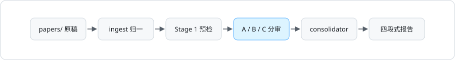

<div align="center">

# thesis-review-pipeline 毕设行止

### *“纸上得来终觉浅”*

<br>

[](https://www.python.org/downloads/)
[](LICENSE)
[](AGENTS.md)
[](AGENTS.md)

面向中文本科毕业设计的 Agent 辅助审阅工作区，支持预检、代码与实验对账、跨轮问题追踪和交付总览。只审不改，默认离线。

</div>

---

## 工作流原理

<p align="center"></p>

稿件从 `papers/` 归一成 Markdown，先过一遍机械预检，查未定义符号、过强断言和结构缺口。
预检之后由 Agent 分三路审查：A 管动机与文献边界，B 管方法严密性，C 管实验充分度和代码–论文对账。
Agent 把三路意见写入 consolidator。`render` 再收成四段式报告和二稿路线图。CLI 不代替深审。

定级分优秀、良好、及格、退修四档。虚构样例，定级退修：[review_report.md](runs/20260917-112554-sample_thesis/review_report.md)

## 快速开始

需要 CPython 3.12。进入仓库后自建虚拟环境，不要用系统里别的 Python 直接装依赖。真实稿件放进 `papers/`，不要入库。

```bash
python -m venv .venv
```

```bash
# Windows
.venv\Scripts\activate
# macOS / Linux
source .venv/bin/activate

python -m pip install -r requirements.txt
```

Windows 上若 `python` 不是 3.12，改用 `py -3.12 -m venv .venv`。

`init-run` 只做归一、机械预检和分审骨架，定级记为「待深审」。它不审完这篇稿。

```bash
python scripts/thesis_review.py init-run papers/你的论文.md --title "题目" --field "专业"
```

跑完后，`runs/<时间>-<稿名>/` 里有预检结果、空的分审 JSON 和一份初稿报告。深审由 Agent 完成：先读并执行 [thesis-review 技能](.agents/skills/thesis-review/SKILL.md)，再按 [分审合同](templates/agents) 填写该 run 下的四个文件。

- `agents/agent_a_motivation.json`：动机与文献边界
- `agents/agent_b_methodology.json`：方法严密性
- `agents/agent_c_experiments.json`：实验充分度，以及数字、结构、超参、实验设计四类代码对账
- `agents/consolidator.json`：汇总；深审结束把 `status` 写成 `done`

CLI 不会自行完成深审。意见写进 JSON 之后，再渲染正式报告：

```bash
python scripts/thesis_review.py render runs/<id>
```

`render` 只根据已有的 `agents/*.json` 生成四段式报告，不补审。

输入可以是 `.md`、`.docx`、`.pdf`、`.tex`、`.typ`。协作约定见 [CONTRIBUTING.md](CONTRIBUTING.md)。

<details>
<summary><b>全部子命令</b></summary>

| 子命令 | 作用 |
| --- | --- |
| `ingest <file>` | 归一为 UTF-8 Markdown；`--versioned` 加时间戳后缀防覆盖 |
| `lint <file>` | Stage 1 预检；`--json` 输出结构化结果 |
| `init-run <file>` | ingest + lint + 分审骨架 + 初稿报告（定级「待深审」） |
| `render <run_dir>` | 按 `agents/*.json` 重渲染四段式报告 |
| `ledger add/close/list` | 跨轮问题台账，报告自动附「跨轮遗留」 |
| `sanitize` | 清洗日志中的本机绝对路径；**提交前必跑** |
| `doctor` | 体检：日志对账、路径泄漏、consolidator 状态、代码–论文对账 |
| `check` | 稳定入口：先跑测试，再跑 doctor |
| `item` / `overview` | 交付条目和一页总览；建议必须 @ 到人 |
| `scope` | 按改动路径选择检查 |
| `pr-check` | 检查 PR 标题、章节、@ 和隐私声明 |
| `audit <file>` | 可选封装 `paper-audit`（仅 `.tex` / `.typ` / `.pdf`，未安装则退出码 2） |

</details>

## 规范索引

给 Agent 看的合同和约束以这些文档为准：

| 文档 | 内容 |
| --- | --- |
| [AGENTS.md](AGENTS.md) | 硬约束与执行入口 |
| [thesis-review 技能](.agents/skills/thesis-review/SKILL.md) | 审稿工作流细则与执行清单 |
| [templates/agents/](templates/agents) | A / B / C / consolidator 分审合同 |
| [templates/review_report.md.j2](templates/review_report.md.j2) | 报告合同的四级标题模板 |
| [docs/worklog.md](docs/worklog.md) | 工作日志 |
| [docs/references.md](docs/references.md) | 外部项目取舍 |
| [CONTRIBUTING.md](CONTRIBUTING.md) | 提交、PR 格式和隐私声明 |

<details>
<summary><b>外部参考</b>（不 fork，只吸收机制）</summary>

| 项目 | 吸收了什么 |
| --- | --- |
| [AliManjotho/open-reviewer](https://github.com/AliManjotho/open-reviewer) | 评分卡、问题–证据表、Markdown + HTML 双输出 |
| [FanBroWell/AI-paper-reviewer](https://github.com/FanBroWell/AI-paper-reviewer) | 过强 claim / 红旗分级 → linter 的 OC* 与 Major / Minor |
| [Ahren09/AgentReview](https://github.com/Ahren09/AgentReview) | 分角色再聚合的流程形状（A / B / C + consolidator） |
| [allenai/marg-reviewer](https://github.com/allenai/marg-reviewer) | 按章节专精的 Agent，替代单篇超长提示词 |
| [maxidl/openreviewer](https://github.com/maxidl/openreviewer) | PDF→Markdown 作为审稿输入 |

论文：[MARG](https://arxiv.org/abs/2401.04259) · [AgentReview](https://arxiv.org/abs/2406.12708) · [OpenReviewer](https://arxiv.org/abs/2412.11948)。
改写类仓库（和「只审不改」相反）以及同名的代码评审 Agent 都不吸收。

</details>

---

<div align="center">

## 献给

# 𝓨𝓲-𝔁𝓾𝓪𝓷 𝓨𝓘𝓝

感谢她给予我的指导，以及我们之间的交流。她重视实践、认真做事的态度，一直影响着我。

题记的“纸上得来终觉浅”就是对她优秀品格的真实写照。

</div>

---

<div align="center">

<sub>公开仓库只跟踪虚构样例 <a href="papers/sample_thesis.md">sample_thesis.md</a> 与对应样例 run；真实毕业设计材料一律不入库 · <a href="LICENSE">MIT</a></sub>

</div>
